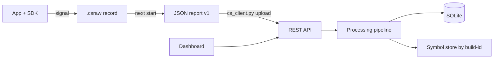
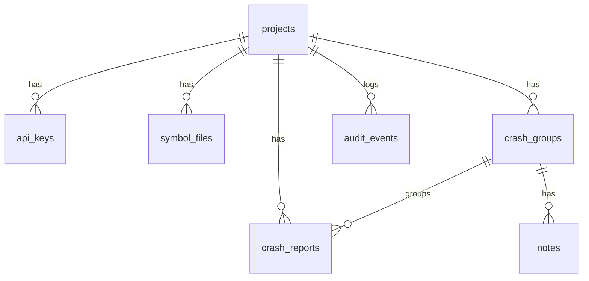

# Architecture overview

Modular monolith. Boundaries: **capture** (`sdk/src/platform_posix.cpp`) → **artifact** (`serialization.cpp`,
schema v1) → **ingestion/API** (`server.py`) → **processing** (`service.py`: validate, store original,
symbolicate, signature, group) → **persistence** (SQLite) → **UI** (`dashboard/index.html`).

## Pipeline (deterministic, synchronous)
receive → authenticate (API key) → size limit → validate → store original artifact → symbolicate (only
build-id-matched symbols of the same project) → signature v1 → find/create group (reopen if resolved) →
record status/error. Failures set `processing_status=failed` + message; `POST /reports/{id}/retry` reprocesses
from the stored original.

## Signature v1
`sha256("v1|<crash_type>|<top 5 application frames>")`. A frame is its demangled function name if symbolicated,
else `module-basename+offset`. System-library frames (`/lib`, `/usr/lib`, vdso) are skipped. Raw addresses are never used.
Each group stores a human-readable `explanation` of the frames used.

## Data model

Unique constraints: `(project_id, report_id)`, `(project_id, signature)`, `(project_id, build_id)`, `key_hash`.
CHECK constraints on group status/severity. Indexes on group, project+time, project+status. Frames are stored once
per report as JSON (processed form); the original artifact is kept on disk under `data/artifacts/<project>/`.

## Lifecycle
new → investigating → confirmed → resolved → (reopened automatically on a new matching report) / ignored.
Severity is set manually (low–critical); it is not inferred from stacks.
